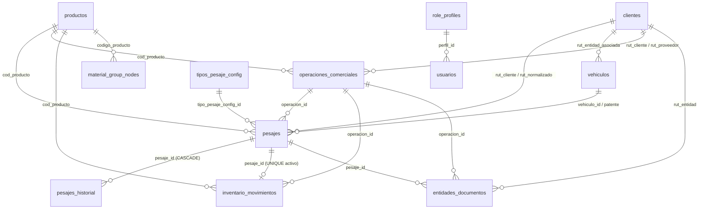

# Modelo de Datos, Diccionario de Campos y Reglas de Pesaje · Gestión de Scrap v5.0.0

## 1. Modelo Entidad-Relación (SQLite WAL · Esquema `v3`)



---

## 2. Migraciones Versionadas (`schema_migrations`)

| Versión | Descripción | Garantía |
| :---: | :--- | :--- |
| **v1** | Esquema base (`pesajes`, `clientes`, `productos`, `material_group_nodes`, `role_profiles`, `usuarios`, `audit_log`, `import_history`, `schema_migrations`). | Creación idempotente `IF NOT EXISTS`. |
| **v2** | 5 índices compuestos de cobertura en `pesajes` y `audit_log` eliminando `TEMP B-TREE` y `FULL SCAN`. | Sin impacto en filas existentes. |
| **v3** | Extensión CRM (`clientes`), catálogo (`productos`), flujo industrial 1/2 mediciones (`pesajes`), 6 tablas nuevas (`vehiculos`, `tipos_pesaje_config`, `operaciones_comerciales`, `inventario_movimientos`, `pesajes_historial`, `entidades_documentos`), backfill de flota histórica, semilla de 9 tipos de pesaje y actualización automática de permisos RBAC `10..13`. | 100 % idempotente (`PRAGMA table_info` previo a `ALTER TABLE`); preserva el 100 % de los registros históricos (`32.178+` pesajes). |

---

## 3. Diccionario de Tablas y Campos

### 3.1 `clientes` (CRM Unificado: Clientes, Proveedores y Mixtos por RUT)

| Campo | Tipo SQLite | Descripción y Regla de Negocio |
| :--- | :--- | :--- |
| `rut` | `TEXT PK` | Cuerpo principal del RUT chileno (sin puntos). |
| `digito` | `TEXT` | Dígito verificador Módulo 11 (`0-9`, `K`). |
| `rut_normalizado` | `TEXT` | Clave normalizada sin ceros iniciales para impedir duplicación de RUT en CRM. |
| `nombre` / `razon_social` | `TEXT` | Razón social oficial de la entidad comercial. |
| `nombre_comercial` | `TEXT` | Nombre de fantasía o comercial. |
| `giro` | `TEXT` | Giro tributario / actividad económica. |
| `direccion`, `comuna`, `ciudad` | `TEXT` | Ubicación comercial y logística. |
| `contacto_nombre`, `telefono`, `email` | `TEXT` | Datos de contacto operativo/comercial. |
| `condicion_comercial` | `TEXT` | Condiciones de pago, retiro o despacho pactadas. |
| `es_cliente`, `es_proveedor` | `INTEGER (0/1)` | Flags unificados (`Cliente`, `Proveedor` o `Cliente y Proveedor`). Al menos uno obligatorio. |
| `activo` | `INTEGER (0/1)` | Estado comercial (`1=Activo`, `0=Inactivo`). Protege historial si tiene pesajes/órdenes. |
| `planta_asociada` | `INTEGER NULL` | Planta preferente (`1=Placilla`, `2=Santiago`, `3=Talcahuano`). |

### 3.2 `productos` (Catálogo Maestro de Materiales)

| Campo | Tipo SQLite | Descripción y Regla de Negocio |
| :--- | :--- | :--- |
| `codigo` | `TEXT PK` | Código único en mayúsculas (compatible 100 % con códigos `WMDBSPC.GDB`). |
| `nombre`, `descripcion` | `TEXT` | Nombre visible y descripción técnica del material. |
| `grupo` | `TEXT` | Grupo de material por defecto (integrado con `material_group_nodes`). |
| `unidad_medida` | `TEXT` | Unidad estricta validada (`KG` o `TON`). |
| `tolerancia_diferencia_pct` | `REAL` | Porcentaje máximo de desviación permitido entre peso esperado y real (por defecto `5.0 %`). |
| `activo` | `INTEGER (0/1)` | Los materiales inactivos no pueden recibir nuevos pesajes ni órdenes. |
| `informacion_adicional` | `TEXT` | Especificaciones técnicas, humedad, formato o notas operacionales. |

### 3.3 `vehiculos` (Maestro de Flota y Patentes Normalizadas)

| Campo | Tipo SQLite | Descripción y Regla de Negocio |
| :--- | :--- | :--- |
| `id` | `INTEGER PK` | Identificador interno del vehículo. |
| `patente_original` | `TEXT` | Formato legible estándar (ej. `AB-CD-12`). |
| `patente_normalizada` | `TEXT UNIQUE` | Clave alfanumérica sin guiones/espacios (`ABCD12`) que impide duplicados (`AB-CD-12` == `abcd12`). |
| `tipo_vehiculo`, `marca`, `modelo` | `TEXT` | Clasificación del transporte (`Camión`, `Tracto Camión`, `Tolva`, `Rampla`, etc.). |
| `capacidad_carga_kg` | `INTEGER` | Capacidad nominal máxima (`>= 0`). |
| `rut_entidad_asociada`, `nombre_entidad_asociada` | `TEXT` | Vinculación opcional con transportista, proveedor o cliente CRM. |
| `activo` | `INTEGER (0/1)` | Vehículos inactivos o inexistentes son rechazados al registrar nuevos pesajes. |

### 3.4 `tipos_pesaje_config` (Tipos de Pesaje Configurables)

| Campo | Tipo SQLite | Descripción |
| :--- | :--- | :--- |
| `codigo`, `nombre` | `TEXT` | Código único (`RECEPCION`, `DESPACHO`, `ENTRADA`, `SALIDA`, `CARGA`, `DESCARGA`, `INDIVIDUAL`, `ENTRADA_SALIDA`, `INTERNO`) y etiqueta. |
| `tipo_base` | `INTEGER` | Enum `TipoPesaje` (`1..9`). |
| `requiere_dos_mediciones` | `INTEGER (0/1)` | Indica si opera en flujo 2 pasos (1ª medición entrada -> 2ª medición salida). |
| `afecta_inventario` / `direccion_inventario` | `INTEGER` | `1` ingreso (+), `-1` egreso (-), `0` neutro (control/traslado interno). |

### 3.5 `pesajes` (Registro Integral de Pesajes Industriales)

| Campo | Tipo SQLite | Descripción y Regla de Negocio |
| :--- | :--- | :--- |
| `id`, `folio`, `folio_codigo` | `INTEGER / TEXT` | `folio_codigo` preserva el formato original exacto del folio (`PL-2026-0001`, `2737`, etc.). |
| `planta`, `tipo_pesaje`, `tipo_pesaje_config_id` | `INTEGER` | Planta operativa y clasificación del pesaje. |
| `patente`, `vehiculo_id`, `acoplado` | `TEXT / INTEGER` | Vehículo asociado (validado contra `vehiculos` en registros nuevos). |
| `peso_bruto`, `peso_tara`, `peso_neto`, `unidad_medida` | `INTEGER / TEXT` | Pesos validados con regla estricta `Neto = Bruto - Tara` y unidad consistente con el material. |
| `cod_producto`, `nom_producto`, `grupo_material` | `TEXT` | Material maestro y grupo consolidado. |
| `rut_cliente`, `nom_cliente` | `TEXT` | Entidad comercial asociada (Cliente o Proveedor CRM). |
| `fecha_ingreso`, `hora_ingreso`, `fecha_salida`, `hora_salida` | `TEXT` | Estampas operacionales de entrada y salida. |
| `bascula`, `operador`, `guia_despacho`, `chofer` | `TEXT` | Trazabilidad de operación en romana y documento asociado. |
| `estado_pesaje` | `INTEGER` | `1=PendienteSegundaMedicion`, `2=Confirmado`, `3=Anulado`, `4=PendienteAutorizacion`. |
| `primera_medicion_kg`, `primera_medicion_utc` | `INTEGER / TEXT` | Valor y marca UTC **inmutables** de la 1ª medición en flujo de 2 pasos. |
| `segunda_medicion_kg`, `segunda_medicion_utc` | `INTEGER / TEXT` | Valor y marca UTC de la 2ª medición. |
| `peso_esperado_kg` | `INTEGER NULL` | Referencia de orden/guía para validación automática de tolerancia. |
| `operacion_id` | `INTEGER NULL` | Vínculo directo con `operaciones_comerciales`. |
| `ajuste_manual_autorizado`, `motivo_ajuste_anulacion`, `modificado_por`, `modificado_en_utc` | `INTEGER / TEXT` | Trazabilidad de correcciones, excepciones y anulaciones autorizadas. |

### 3.6 `operaciones_comerciales`, `inventario_movimientos`, `pesajes_historial`, `entidades_documentos`

- **`operaciones_comerciales`:** Órdenes ERP (`OrdenCompra`, `OrdenVenta`, `RecepcionMaterial`, `EntregaDespacho`, `TrasladoInterno`) con seguimiento automático de `cantidad_esperada_kg` vs `cantidad_real_kg` (recalculada desde pesajes confirmados vinculados) y estado (`Abierta`, `EnProceso`, `Completada`, `Anulada`, `PendienteAutorizacion`).
- **`inventario_movimientos`:** Libro mayor **inmutable** de inventario (`Entrada`, `Salida`, `Recepcion`, `Despacho`, `AjustePositivo`, `AjusteNegativo`, `ReversoAnulacion`). Posee índice único parcial:
  ```sql
  CREATE UNIQUE INDEX idx_inv_mov_pesaje_activo
      ON inventario_movimientos(pesaje_id)
      WHERE pesaje_id IS NOT NULL AND tipo_movimiento != 7 AND anulado = 0;
  ```
  Esto garantiza a nivel de base de datos que **ningún pesaje puede generar movimientos duplicados de inventario**.
- **`pesajes_historial`:** Bitácora inmutable de estados y pesos anterior/nuevo (`peso_bruto_*`, `peso_tara_*`, `peso_neto_*`, `estado_*`, `usuario`, `motivo`) por cada creación, cierre de 2ª medición, autorización, corrección o anulación.
- **`entidades_documentos`:** Documentos comerciales y tributarios (Guías, Facturas, Contratos, Certificados) vinculados a entidades CRM, operaciones o pesajes.

---

## 4. Procedimientos y Reglas Estrictas de Cálculo (`WeighingRules`)

1. **Pesaje Directo (1 Paso):**
   - Valida vehículo activo registrado, material activo y consistencia exacta de unidad (`KG` / `TON`).
   - Exige `PesoBruto > 0`, `PesoTara >= 0` y `PesoBruto >= PesoTara`.
   - Calcula determinísticamente `PesoNeto = PesoBruto - PesoTara >= 0`.
   - **Prohíbe sobrescribir `PesoNeto` manualmente** salvo permiso `AutorizarAnularPesajesInventario` + flag `AjusteManualAutorizado` + motivo obligatorio registrado.
2. **Pesaje en Dos Mediciones (Entrada y Salida):**
   - **Etapa 1 (`IniciarPesajeDosMedicionesAsync`):** Exige `PrimeraMedicionKg > 0`, guarda `PrimeraMedicionUtc`, marca `Estado = PendienteSegundaMedicion` y `PesoNeto = 0`. **Nunca calcula peso neto definitivo ni impacta el inventario en esta etapa.**
   - **Etapa 2 (`CompletarSegundaMedicionAsync`):** Conserva intactos `PrimeraMedicionKg` y `PrimeraMedicionUtc`, calcula `Bruto = max(M1, M2)`, `Tara = min(M1, M2)`, `Neto = Bruto - Tara`, bloquea cierres duplicados sobre un pesaje ya cerrado, y genera **exactamente un** asiento de inventario al pasar a `Confirmado`.
3. **Control de Tolerancia y Autorización:**
   - Si existe `PesoEsperadoKg` (manual o heredado de la orden ERP), calcula `|Neto - Esperado| / Esperado * 100`.
   - Si supera `Producto.ToleranciaDiferenciaPct` y no media autorización previa (`AutorizarAnularPesajesInventario`), el pesaje queda en `PendienteAutorizacion` **sin afectar inventario** hasta ser aprobado en `AutorizarPesajePendienteAsync`.
4. **Correcciones, Anulaciones e Invariante de Inventario:**
   - Los pesajes confirmados **nunca se eliminan físicamente**.
   - Una corrección autorizada registra el delta en `pesajes_historial`, marca el movimiento de inventario previo como `anulado = 1`, emite un asiento `ReversoAnulacion` por `-cantidad_anterior` y emite el nuevo asiento por `cantidad_nueva`.
   - Una anulación cambia el estado a `Anulado`, registra `pesajes_historial` y emite un `ReversoAnulacion` que restaura el stock exacto.
   - **Invariante contable permanente:** `StockActualKg == SUM(cantidad_kg) == EntradasKg - SalidasKg + AjustesKg`.
